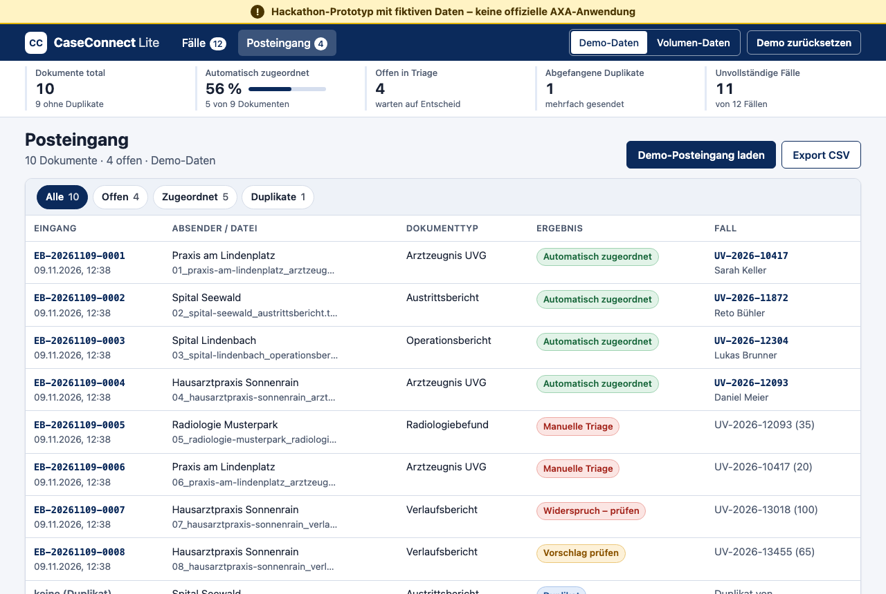
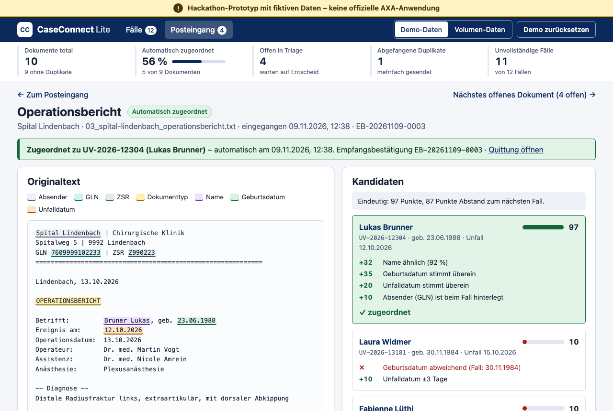

# CaseConnect Lite

> **Hackathon-Prototyp mit fiktiven Daten – keine offizielle AXA-Anwendung.**

**Live:** https://rexliz.github.io/axa-miniapp-caseconnect/

Mini-App für die UVG-Fallführung: Sie ordnet eingehende medizinische Berichte automatisch dem richtigen Schadenfall zu, fängt Duplikate ab, stellt Empfangsbestätigungen aus und zeigt, welche Unterlagen noch fehlen.

Entstanden am AXA-Hackathon (10./11. November 2026) als eine der Beispiel-Apps für **«AXA Mini Apps – Citizen Development Boost Factory» («AXA LOS!»)**: Mitarbeitende bauen eigene Mini-Apps schnell, sicher und governance-konform, zum Beispiel aus einer Excel-Liste.



## Problem

Bei einem UVG-Unfall braucht die Unfallversicherung medizinische Unterlagen von Spitälern und Ärzten: Arztzeugnis UVG, Austrittsbericht, Operationsbericht, Radiologiebefund und Verlaufsbericht. Diese kommen meist unstrukturiert per Mail, oft **ohne Schaden-Nr.** Die Folgen:

- Berichte lassen sich keinem Schadenfall zuordnen.
- Spitäler erhalten keine Empfangsbestätigung und **schicken Berichte mehrfach**.
- Niemand sieht, **was noch fehlt**.
- Fallbeurteilung und Auszahlung an die verunfallte Person verzögern sich.

## Lösung

| Schritt | Was die App macht |
|---|---|
| **Fallliste aus Excel** | Lädt `faelle.xlsx` (oder eine eigene .xlsx/.csv) und zeigt die Fälle mit Suche und Vollständigkeits-Ampel. |
| **Posteingang** | Demo-Berichte laden, Text einfügen oder `.txt` per Drag & Drop ablegen |
| **Extraktion** | Liest Dokumenttyp, Schaden-Nr., Name, Geburtsdatum, Unfalldatum, GLN und ZSR aus und markiert die Fundstellen farbig im Originaltext. |
| **Zuordnung mit Konfidenz** | Zeigt die drei besten Fälle mit Score 0–100 und Begründung. Bestätigen, anderen Fall wählen oder an die manuelle Triage geben. «Nächstes offenes Dokument» führt durch alle offenen Fälle, ohne Umweg über den Posteingang. |
| **Widerspruch** | Passt die Schaden-Nr. nicht zum Namen, ordnet die App **nicht** zu, denn ein falsch zugeordneter Arztbericht wäre ein Datenschutzvorfall. |
| **Duplikate** | Bei gleichem Inhalt (SHA-256 über den normalisierten Text) zeigt sie «Bereits eingegangen am …, Eingangs-ID …». |
| **Empfangsbestätigung** | Eingangs-ID `EB-JJJJMMTT-0001`, druckbar und als Text kopierbar |
| **Vollständigkeit und Nachforderung** | Checkliste je Falltyp. Der Anfragetext an Spital bzw. Arbeitgeber enthält nur, was wirklich fehlt. |
| **Kennzahlen** | Dokumente total, Anteil automatisch zugeordnet, offen in Triage, abgefangene Duplikate, unvollständige Fälle |
| **Datensätze** | Demo (12 Fälle, 10 Szenarien) und Volumen (150 Fälle, 300 Berichte, rund 89 % automatisch) |
| **Persistenz** | Der Zustand liegt im Browser (localStorage). Dazu kommen «Demo zurücksetzen» (oben rechts) und ein CSV-Export der Zuordnungen (im Posteingang). |



### So wird zugeordnet

Die Regeln stehen zentral in [`src/js/config.js`](src/js/config.js).

- **Schaden-Nr. gefunden und vorhanden:** Score 100. Widersprechen Name oder Geburtsdatum, lautet der Status «Widerspruch – prüfen».
- **Sonst Punkte:**
  - Name bis 35 (Levenshtein, unabhängig von Gross-/Kleinschreibung, Umlauten und Reihenfolge)
  - Geburtsdatum 35
  - Unfalldatum 20 (±3 Tage: 10)
  - GLN/ZSR des Absenders beim Fall hinterlegt: 10
- **Status:**
  - «automatisch» ab 85 Punkten und mindestens 15 Punkten Abstand zum Zweitbesten
  - «Vorschlag prüfen» bei 50–84 Punkten
  - sonst «manuelle Triage»

Die Extraktion ist regelbasiert (Regex und Schlüsselwörter) und hat eine klare Schnittstelle: `extract(text) → { dokumenttyp, felder, fundstellen, hinweise }`. **Ein Sprachmodell könnte diese eine Funktion später ersetzen**, ohne dass sich Matching, Duplikaterkennung oder Oberfläche ändern.

## Lokal starten

Voraussetzung: Node.js 22 oder neuer. Es gibt **keine npm-Abhängigkeiten**, deshalb ist kein `npm install` nötig.

```bash
npm start              # lokaler Server auf http://localhost:8080/
npm test               # alle Tests (node --test)
npm run generate-data  # Mockdaten neu erzeugen (deterministisch)
```

ES-Module laufen nicht über `file://`. Deshalb startet `npm start` einen kleinen statischen Server ([`scripts/serve.mjs`](scripts/serve.mjs)), der auch ohne Internet funktioniert.

## Vom Excel zur Mini-App

Die Fallliste ist eine gewöhnliche Excel-Datei. So tauschst du sie aus, **ohne Code zu ändern**:

1. **Spalten** (Reihenfolge egal, Gross-/Kleinschreibung und «Schaden-Nr.» statt `schaden_nr` sind ok):
   `schaden_nr, vorname, nachname, geburtsdatum, unfalldatum, falltyp, arbeitgeber, leistungserbringer, leistungserbringer_gln, leistungserbringer_zsr, sachbearbeitung`
   Pflicht sind nur `schaden_nr`, `vorname` und `nachname`.
2. **Datumswerte** dürfen echte Excel-Daten oder Text `TT.MM.JJJJ` sein.
3. **Falltyp** ist `Bagatellunfall`, `Unfall mit Arbeitsunfähigkeit` oder `Unfall mit Hospitalisation` und bestimmt die Checkliste.
4. **Ausprobieren:** In der App auf «Eigene Excel/CSV laden» klicken. Fehlende Spalten oder ungültige Werte meldet die App verständlich, statt abzustürzen.
5. **Dauerhaft ersetzen:** `src/data/faelle.xlsx` überschreiben, committen und pushen. Der Workflow testet und veröffentlicht automatisch.

Wer die Regeln ändern will (Schwellwerte, Gewichte, Schlüsselwörter, nötige Unterlagen je Falltyp), passt nur [`src/js/config.js`](src/js/config.js) an.

## Steckbrief `miniapp.json`

[`miniapp.json`](miniapp.json) ist unser **Vorschlag für den Governance-Rahmen von «AXA LOS!»**: Jede Mini-App beschreibt sich selbst in einer maschinenlesbaren Datei. Darin stehen Zweck, Zielgruppe, Owner, Status, Datenquelle, Datenklassifizierung, Personendaten ja/nein, Netzwerkzugriffe, externe Abhängigkeiten und Hosting. Eine Plattform könnte damit automatisch prüfen, ob eine App freigegeben werden darf (z. B. «Personendaten: nein, Netzwerkzugriffe: keine → Prototyp ok»), und einen Katalog aller Mini-Apps anzeigen.

## Sicherheit und Datenschutz

- **Nur Mockdaten**, selbst generiert und deterministisch. Siehe [`docs/mockdaten.md`](docs/mockdaten.md).
- **Content-Security-Policy** `default-src 'self'` per Meta-Tag: keine Inline-Scripts, keine Inline-Styles, keine externen Quellen. [`tests/security.test.js`](tests/security.test.js) prüft das bei jedem Push.
- **Keine Netzwerkzugriffe** ausser auf die eigene Seite. SheetJS liegt lokal unter `src/vendor/` (kein CDN zur Laufzeit).
- **Kein Backend, keine Secrets.** Alle Daten bleiben im Browser.
- **Deploy nur bei grünen Tests:** [`.github/workflows/pages.yml`](.github/workflows/pages.yml) führt `npm test` aus und veröffentlicht danach `src/` auf GitHub Pages.

## Tests

`npm test` führt über 70 Tests aus, ohne Test-Framework (`node --test`):

- **Extraktion:** jedes Feld, GLN-Prüfziffer, Dokumenttypen, Fundstellen
- **Matching:** Punkteregeln, Status, **alle 10 Demo-Szenarien** aus `index.json` und **alle 300 Volumen-Berichte**
- **Prozess:** Vollständigkeit, Duplikaterkennung (eigene SHA-256-Implementierung, geprüft gegen `node:crypto`), Quittung, Nachforderung, Kennzahlen, CSV-Export
- **Excel/CSV-Import** (Datum als Seriennummer und als Text)
- **Mockdaten:** Fiktivitäts-Regeln, Datumslogik, **byte-identischer Generator-Lauf**
- **Security-Leitplanken** der Seite

## Projektstruktur

```
axa-miniapp-caseconnect/
├── .github/workflows/pages.yml   # Test + Deploy auf GitHub Pages
├── src/                          # wird 1:1 veröffentlicht
│   ├── index.html                # CSP, Banner, App-Hülle
│   ├── css/styles.css            # Design-Tokens, Layout, Print-CSS
│   ├── js/
│   │   ├── main.js               # Einstieg, Routing, Kopfzeile
│   │   ├── state.js              # Zustand + localStorage (try/catch)
│   │   ├── config.js             # Regeln, Schwellwerte, Schlüsselwörter
│   │   ├── core/                 # reine Logik ohne DOM, vollständig getestet
│   │   │   ├── extract.js        # Extraktion (austauschbar)
│   │   │   ├── match.js          # Score + Status + Begründung
│   │   │   ├── duplicate.js      # SHA-256 über normalisierten Text
│   │   │   ├── pipeline.js       # Dokument rein → Ergebnis raus
│   │   │   ├── completeness.js   # Checkliste je Falltyp
│   │   │   ├── request.js        # Nachforderungstexte
│   │   │   ├── receipt.js        # Eingangs-ID + Quittung
│   │   │   ├── kpis.js, export.js, cases.js, dates.js, gln.js, normalize.js
│   │   ├── io/                   # Excel/CSV (SheetJS) und Posteingang laden
│   │   └── ui/                   # eine Datei pro Ansicht
│   ├── data/                     # Mockdaten (generiert, committet)
│   └── vendor/                   # SheetJS 0.20.3 (Apache-2.0), lokal
├── tests/                        # node --test
├── scripts/                      # generate-mockdata.mjs, serve.mjs
├── docs/                         # Mockdaten, Demo-Skript, Entscheidungen
├── miniapp.json                  # Steckbrief (Governance-Vorschlag)
├── CLAUDE.md                     # Projektregeln für KI-gestützte Sessions
└── package.json                  # Scripts: start, test, generate-data
```

## Grenzen des Prototyps

- **Nur Text:** Berichte als Text oder `.txt`. PDFs, Scans und OCR gibt es noch nicht.
- **Regelbasierte Extraktion:** Sie erkennt die Formate der Mockdaten zuverlässig. Bei echten, sehr freien Berichten bräuchte es mehr Regeln oder ein Sprachmodell hinter derselben Schnittstelle.
- **Vereinfachte Regeln:** Die Vollständigkeitsregeln und das Punkteschema sind Annahmen und fachlich nicht validiert.
- **Keine Anbindung:** Kein Kernsystem, kein MedReg oder SASIS, kein Mailversand. Quittung und Nachforderung werden kopiert, nicht verschickt.
- **Kein Login:** keine Rollen, kein Audit-Trail. Der Zustand liegt nur im Browser und ist nicht zwischen Personen geteilt.
- **Kleine Datenmengen:** Für einige hundert Dokumente im Browser gedacht, nicht für Produktionsvolumen.
- **Nicht für echte Daten freigegeben.**

## Weitere Dokumentation

- [`docs/mockdaten.md`](docs/mockdaten.md): wie die Daten entstehen, Fiktivitäts-Regeln, die 10 Szenarien
- [`docs/demo-skript.md`](docs/demo-skript.md): Ablauf der 3-Minuten-Live-Demo
- [`docs/entscheidungen.md`](docs/entscheidungen.md): kleinere Entscheidungen während der Umsetzung

## Team und Lizenzen

ZHAW-Team Wirtschaftsinformatik (3 Personen), AXA-Hackathon 2026. Alle Personen, Fälle, Spitäler und Firmen sind frei erfunden.
SheetJS Community Edition steht unter der Apache-2.0-Lizenz (siehe `src/vendor/LICENSE-sheetjs.txt`).
